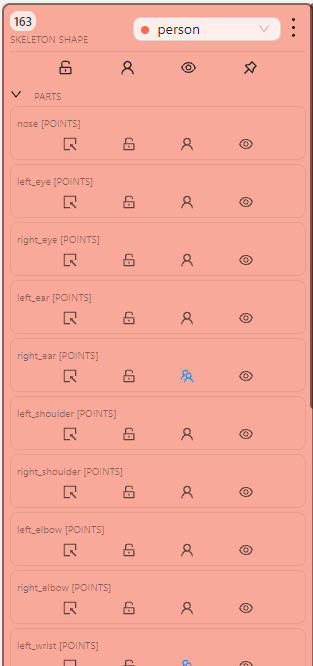
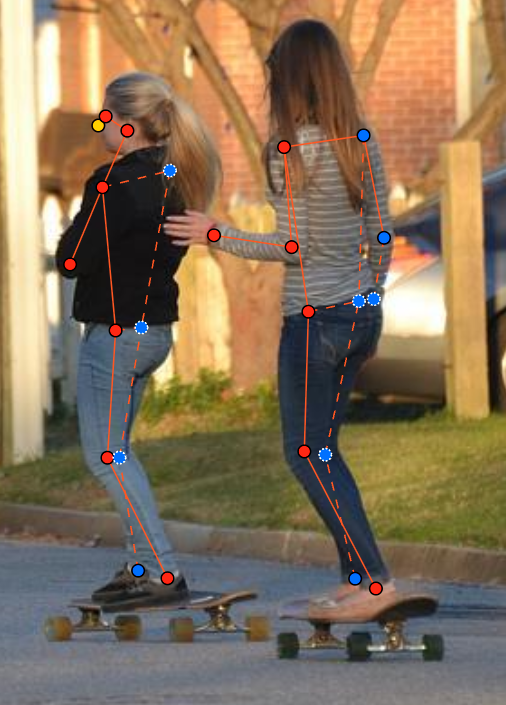
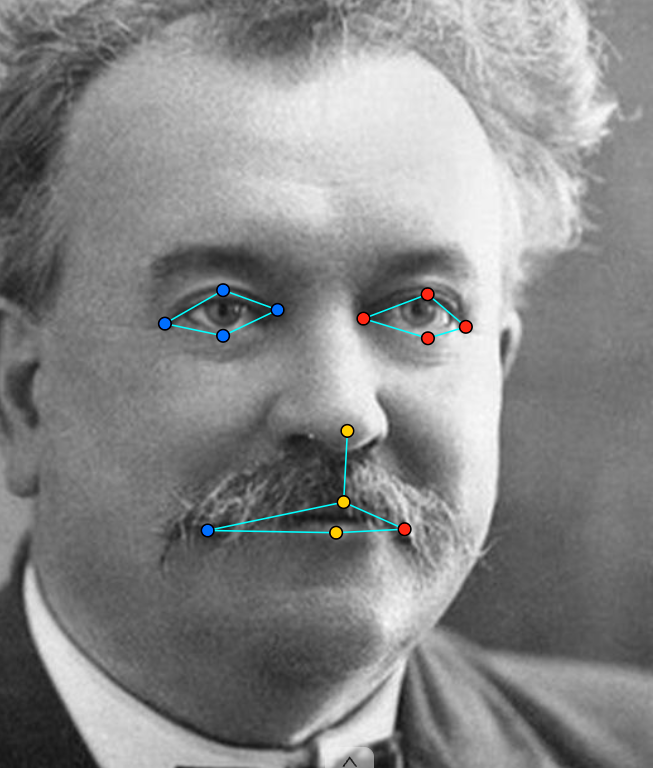
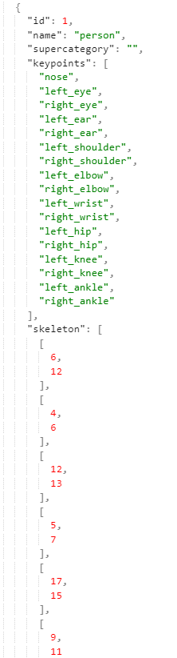

# Báo cáo cá nhân — LaThaiHoa-2A202603069

Đổi tên file theo quy tắc `MSSV_HoTen.md`. Ví dụ: `20241234_NguyenVanAn.md`.

Dữ liệu: 12 ảnh người COCO val2017 (Lin et al., 2014) và 8 ảnh chân dung Wikimedia Commons, chỉ dùng trong lớp.

## 0. Thông tin học viên

- Họ tên: Lã Thái Hòa
- MSSV: 2A202603069
- Email: lathaihoa2003@gmail.com
- Link repository: https://github.com/Zeus-AIE/cd-K5-L2A-DAY04-LaThaiHoa-2A202603069-KeypointPose
- Phiên bản CVAT (Help → About): CVAT 2.82.1
- Máy: hệ điều hành Win 11 · RAM 16 GB · chạy CVAT chế độ đầy đủ
- Bộ ảnh (`src/exports/assignment.json` do `lab.py setup` tạo): có
- Giờ bắt đầu: 16:50
- Giờ kết thúc: 18:10 (hoàn thành bài chính; sau đó tiếp tục triển khai bonus)

## 1. Kiểm tra label (CP0)

| Label | Kiểu | Số điểm | Tên điểm đúng bảng của lab? | Đúng thứ tự? | Số cạnh |
|---|---|---:|---|---|---:|
| `person` | Skeleton | 17 | Có | Có | 19 |
| `face` | Skeleton | 13 | Có | Có | 13 |

Mẫu `person` dựng theo người quay mặt về camera (các điểm `left_*` nằm bên phải khung mẫu)? Có

Cách đổi cờ `occluded` / `outside` cho **một điểm** trên phiên bản CVAT này (một câu):

Rê chuột vào đúng điểm cần đổi (điểm sáng lên), bấm phím `Q` để đổi thành `occluded` (`v = 1`), bấm phím `O` để đổi thành `outside` (`v = 0`), hoặc click chuột phải vào điểm để chọn trong menu ngữ cảnh.

## 2. Số lượng đã gán và thời gian (CP1, CP2)

| Nhóm ảnh | Số ảnh | Số skeleton đã gán | Số người dưới 60 px (không gán) | Số poster / gương / màn hình bỏ qua | Thời gian (phút) |
|---|---:|---:|---:|---:|---:|
| `easy` | 5 | 5 | 0 | 0 | 18 |
| `occluded` | 3 | 6 | 0 | 0 | 15 |
| `back` | 2 | 4 | 0 | 0 | 12 |
| `small` | 1 | 0 | 2 | 0 | 5 |
| `crowd` | 1 | 3 | 1 | 0 | 10 |
| `faces` | 8 | 8 | — | 0 | 15 |

- Số ảnh người đã xong ở mốc phút 105: 10 / 10
- Thời gian thực tế (phút): CP1 ~45 · CP2 ~15 · CP3 ~10 · CP4 ~5 (Tổng bài chính: 80 phút, từ 16:50 đến 18:10)
- Ảnh tốn thời gian nhất là ảnh nào, vì sao?

Những bức ảnh có người quay lưng lại hoặc đứng nghiêng (thuộc nhóm `back` như `000000210604.jpg`, `000000311300.jpg`). Lý do vì khung mẫu skeleton mặc định của CVAT được thiết kế cho trường hợp trực diện (các điểm `left_*` nằm bên phải khung mẫu). Khi gặp người quay lưng hoặc đứng nghiêng, người gán nhãn bắt buộc phải hoán đổi vị trí thủ công toàn bộ các cặp điểm trái/phải (`left_*` sang trái ảnh, `right_*` sang phải ảnh) và di chuyển các điểm nhiều hơn, căn chỉnh lại từng trục xương để tránh bị lỗi `lr_swap`.

## 3. Bảng ca khó (CP1, CP2)

Mỗi điểm bạn phân vân một dòng, nhất là phân vân giữa `v = 1` và `v = 0`, hoặc không chắc hướng người.

| Ảnh | Người / mặt | Điểm | Cờ đã chọn | Phân vân giữa | Lý do chọn |
|---|---|---|---:|---|---|
| `000000323705.jpg` | Hậu cảnh đồng hồ | Toàn bộ skeleton | 0 | Gán hay bỏ qua | Hậu cảnh phía sau đồng hồ bị ngược sáng nặng, camera chỉ thể hiện hình dạng người như các bóng đen mờ, không thể xác định được các thành phần khung xương giải phẫu. Tuân thủ nguyên tắc "không đoán bừa" nên không gán skeleton. |
| `000000056651.jpg` | Người #1 | `left_knee`, `left_ankle` | 0 | `v = 1` và `v = 0` | Chân trái nằm hoàn toàn ra ngoài mép dưới ảnh, không thể ước lượng chắc chắn vị trí khớp nên tuân thủ nguyên tắc đặt `outside`, không kéo về mép. |
| `000000056651.jpg` | Người #2 | `right_wrist` | 1 | `v = 2` và `v = 1` | Cổ tay phải bị che một phần bởi vật cầm phía trước nhưng nhìn rõ cẳng tay và bàn tay nên ước lượng chắc chắn vị trí khớp. |
| `000000156986.jpg` | Người #1 | `left_hip`, `right_hip` | 0 | `v = 1` và `v = 0` | Người bị che khuất từ vùng bụng trở xuống bởi vật cản lớn, không đủ dữ liệu hình học cơ thể để nội suy chính xác vị trí hông nên chọn `v = 0`. |
| `000000157271.jpg` | Người #1 | `right_ankle`, `left_ankle` | 1 | `v = 1` và `v = 0` | Bàn chân bị vạt cỏ che khuất một phần nhưng thấy rõ cẳng chân hướng xuống đất nên ước lượng được tâm mắt cá chân. |
| `000000311300.jpg` | Người #1 | `left_ankle`, `right_ankle` | 1 | `v = 1` và `v = 2` | Người đứng trên ván trượt, chân bắt chéo và bị che một phần bởi tà áo/quần dài, cần suy đoán khớp giải phẫu dựa trên trục xương cẳng chân. |
| `face_476363.jpg` | Mặt | `right_eye_outer`, `mouth_right` | 1 | `v = 1` và `v = 2` | Nhân vật áp điện thoại di động vào tai phải khi cười, tay và điện thoại che một phần má và khóe miệng phải, bóng đổ lên khóe mắt ngoài bên phải nên đặt cờ `occluded`. |
| `face_256814.jpg` | Mặt | 8 điểm vùng mắt (`*_eye_*`) | 0 | `v = 1` và `v = 0` | Nhân vật đeo kính râm đen to bản che kín hoàn toàn hai mắt, tròng kính đen kịt không thể nhìn thấy viền mí hay con ngươi, tuân thủ nguyên tắc không đoán bừa nên đặt `outside`. |

## 4. Bảng tự review (CP3)

Đi từ ảnh cuối về ảnh đầu. 5 ảnh người (ít nhất 2 ảnh `back` hoặc `crowd`) và 3 ảnh mặt. Ít nhất 8 dòng, kể cả dòng `ok`. Ghi lỗi trước, sửa sau.

Mã lỗi dùng đúng một trong: `lr_swap`, `vis_flag`, `position`, `missing`, `extra`, `ok`.

| Ảnh | Người / mặt | Điểm | Mã lỗi | Ghi chú | Đã sửa? |
|---|---|---|---|---|---|
| `000000381889.jpg` | Người nam áo xanh lá (#2) | `left_wrist`, `left_elbow` | `vis_flag` | Cùng cầm dao cắt bánh cưới với người nữ, tay người nam đặt chồng lên tay người nữ. Ban đầu để v=2, rà soát lại thấy cổ tay và khuỷu tay trái bị che một phần nên đổi sang `occluded` (v=1) | Đã sửa: Có |
| `000000311300.jpg` | Người mặc áo sọc trượt ván (#1) | Toàn bộ skeleton | `lr_swap` | Người trượt ván quay lưng/nghiêng về phía xa, khung mẫu mặc định là trực diện nên các điểm trái/phải bị ngược chiều. Đã hoán đổi toàn bộ các cặp điểm sang đúng hướng cơ thể | Đã sửa: Có |
| `000000311300.jpg` | Người mặc áo khoác đen (#2) | `left_ankle`, `right_ankle` | `position` | Tư thế chân trước chân sau trên ván trượt, điểm mắt cá chân sau ban đầu bị đặt hơi lệch so với trục cẳng chân. Đã căn chỉnh lại đúng tâm khớp mắt cá chân | Đã sửa: Có |
| `000000210604.jpg` | Vận động viên áo vàng chanh (#1) | `nose`, `left_eye`, `right_eye`, `right_ear` | `vis_flag` | Người quay lưng hoàn toàn về phía camera khi nhảy tranh đĩa, toàn bộ khuôn mặt ngửa lên và quay đi. Đã rà soát và chuyển các điểm mắt, mũi sang `outside` (v=0) | Đã sửa: Có |
| `000000157271.jpg` | Cầu thủ áo trắng phòng thủ (#1) | `left_elbow`, `left_wrist` | `vis_flag` | Cầu thủ áo trắng cúi người chặn đĩa, tay trái bị lưng cầu thủ áo xanh số 17 che khuất một phần. Đã đổi cờ từ v=2 sang `occluded` (v=1) | Đã sửa: Có |
| `face_490361.jpg` | Cô gái cắt tóc mái | Toàn bộ 13 điểm | `ok` | Khuôn mặt góc thẳng, ánh sáng rõ nét, dù có kéo tỉa tóc phía trước trán nhưng toàn bộ hai mắt, sống mũi và khóe miệng đều thấy rõ, các điểm đặt chính xác ở mép | Không (đã đạt) |
| `face_476363.jpg` | Người đàn ông nghe điện thoại | `right_eye_outer`, `mouth_right` | `vis_flag` | Bàn tay cầm điện thoại áp sát tai phải và che một phần má, khóe miệng phải. Đã rà soát và đổi điểm khóe miệng phải sang `occluded` (v=1) | Đã sửa: Có |
| `face_256814.jpg` | Người đàn ông đeo kính râm đen | 8 điểm vùng mắt (`*_eye_*`) | `vis_flag` | Tròng kính râm màu đen sẫm che phủ hoàn toàn hai mắt, không thể nhìn thấy mí mắt và con ngươi. Đã chuyển cả 8 điểm mắt về `outside` (v=0) theo đúng nguyên tắc không đoán bừa | Đã sửa: Có |

Tổng hợp số lỗi theo mã:

| `lr_swap` | `vis_flag` | `position` | `missing` | `extra` | `ok` |
|---:|---:|---:|---:|---:|---:|
| 1 | 4 | 2 | 0 | 0 | 1 |

Điểm còn phân vân giữa `v = 1` và `v = 0` (ghi cả hai lựa chọn và lý do chọn):

- Ở ảnh khuôn mặt đeo kính râm đen sẫm (`face_256814.jpg`): Giữa việc chọn `v = 1` (ước lượng vị trí mắt theo gọng kính râm) và `v = 0` (bật outside). Quyết định chọn `v = 0` vì kính quá tối, hoàn toàn không thấy ranh giới mí mắt trên/dưới và khóe mắt, việc đoán bừa tọa độ sẽ làm sai lệch nghiêm trọng tỷ số mở mắt (EAR) trong các bài toán theo dõi trạng thái tài xế.
- Ở ảnh hai vận động viên tranh đĩa trên không (`000000210604.jpg`): Với các điểm mắt, mũi của vận động viên áo vàng chanh nhảy quay lưng. Giữa việc chọn `v = 1` (phỏng đoán vị trí mắt mũi dựa theo hộp sọ) và `v = 0` (bật outside). Quyết định chọn `v = 0` vì cơ thể và đầu ngửa hoàn toàn về phía sau, các điểm này thực tế nằm ngoài góc nhìn camera, chọn `v = 0` để hàm loss mask bỏ điểm, không ép model học đỉnh heatmap ảo.

## 5. Kiểm file xuất và kết quả tự kiểm (CP4)

Tự kiểm tay trong file JSON:

| File | Người / mặt kiểm (ảnh, thứ tự) | Số phần tử `keypoints` | Điểm `outside` ra `v = 0`, `occluded` ra `v = 1`? | `num_keypoints` khớp? |
|---|---|---:|---|---|
| `LaThaiHoa_persons.zip` | `000000056651.jpg` (#1) | 51 | Có (`v=0`: 9 điểm, `v=1`: 1 điểm) | Có (`num_keypoints` = 8) |
| `LaThaiHoa_persons.zip` | `000000150500.jpg` (#1) | 51 | Có (`v=0`: 3 điểm, `v=1`: 0 điểm) | Có (`num_keypoints` = 14) |
| `LaThaiHoa_faces.zip` | `face_476363.jpg` (#1) | 39 | Có (`v=0`: 0 điểm, `v=1`: 3 điểm) | Có (`num_keypoints` = 13) |

Sau khi xuất, CVAT ghi `occluded` thành `v = 1` và `outside` thành `v = 0`. Tọa độ của điểm `outside` trong file là `0, 0` hay tọa độ cũ? `tọa độ cũ` (CVAT 2.x xuất như vậy, chuẩn COCO ghi `0, 0`. Điểm `v = 0` được bỏ qua khi huấn luyện và chấm điểm).

Hai job đã chuyển sang completed trên CVAT? Có

Dán phần **TÓM TẮT** in ra từ `src/check_submission.py`:

```text
- File person: LaThaiHoa_persons.zip
  Số ảnh: 12 · số skeleton `person`: 18 · mỗi annotation 51 số
  Skeleton theo ảnh: 000000056651=2, 000000150500=1, 000000156986=2, 000000157271=2, 000000210604=2, 000000295358=1, 000000311300=2, 000000323705=0, 000000381889=3, 000000399983=1, 000000463932=1, 000000564304=1
  Cờ v: v=2 223 (73%) · v=1 28 (9%) · v=0 55 (18%)
  num_keypoints trung bình: 13.9
- File face: LaThaiHoa_faces.zip
  Số ảnh: 8 · số skeleton `face`: 8 · mỗi annotation 39 số
  Skeleton theo ảnh: face_137371=1, face_256814=1, face_300399=1, face_425647=1, face_469647=1, face_476363=1, face_490361=1, face_504911=1
  Cờ v: v=2 93 (89%) · v=1 3 (3%) · v=0 8 (8%)
  num_keypoints trung bình: 12.0
- Ghi chú: 63 điểm v = 0 vẫn mang tọa độ cũ (CVAT 2.x xuất như vậy; chuẩn COCO ghi 0, 0). Không phải lỗi: điểm v = 0 bị bỏ qua khi huấn luyện và khi chấm.
- Số [LỖI]: 0 · số [CẢNH BÁO]: 4
Kết quả: ĐẠT (đọc lại từng cảnh báo ở trên)
```

Các `[CẢNH BÁO]` còn giữ nguyên và lý do:

1. `000000056651.jpg #2`: Cảnh báo cặp wrist nằm ngược phía. Lý do: Nhân vật đang đưa hai tay bắt chéo phía trước khi cầm/giữ vật dụng (bánh sinh nhật). Đây là tư thế tự nhiên của khớp giải phẫu trên người thật, không phải lỗi hoán đổi trái/phải (`lr_swap`).
2. `000000311300.jpg #1` và `#2`: Cảnh báo cặp ankle nằm ngược phía. Lý do: Nhân vật đứng thế trượt ván (chân trước chân sau dọc theo chiều dài ván trượt). Các điểm gắn đúng vị trí giải phẫu khớp mắt cá chân của từng chân nên trục tọa độ x bị đảo chiều tương đối so với thân người.
3. `000000323705.jpg: không có skeleton person nào`: Ảnh này chụp đồng hồ lớn tại nhà ga Grand Central (nhóm `small`). Do điều kiện ngược sáng mạnh từ hậu cảnh, các nhân vật phía sau chỉ xuất hiện dưới dạng bóng đen mờ (silhouette) và có kích thước nhỏ dưới 60 px, hoàn toàn không thấy chi tiết khung xương giải phẫu. Tuân thủ nghiêm ngặt quy tắc khoa học dữ liệu "không đoán bừa" của bài lab, em chủ động không tạo skeleton ảo để tránh làm sai lệch phân phối loss của mô hình.

## 6. Ảnh chụp màn hình

1. Label `person` trong label constructor (đủ 17 điểm có tên):

   

2. Một người quay lưng đã gán, cờ đã đặt:

   

3. Một khuôn mặt đã gán 13 điểm, phóng to vùng mắt:

   

4. Một đoạn JSON xuất của một người:

   

Nguồn ảnh: COCO val2017 / Wikimedia Commons / CVAT 2.82 cá nhân.

## 7. Tự đánh giá

1. Lỗi bạn mắc nhiều nhất hôm nay, và cách bạn sẽ tránh ở dự án thật:

   Lỗi dễ mắc nhất là quên đổi cặp trái/phải khi gặp người quay lưng hoặc đứng nghiêng (`lr_swap`), do thói quen nhìn theo góc nhìn của người quan sát thay vì đứng vào vị trí nhân vật trong ảnh, kết hợp với việc skeleton mẫu của CVAT là người trực diện. Cách tránh trong dự án thật: Luôn tuân thủ quy tắc "Nói to hướng người trước khi kéo điểm", nếu là người quay lưng thì ngay lập tức hoán đổi vị trí các điểm `left_*` và `right_*` trên khung mẫu trước khi tiến hành vi chỉnh từng khớp.

2. Một quy tắc bạn đề xuất thêm vào guideline (kèm ảnh ví dụ nếu có):

   Với các ca chân/tay bắt chéo nhau hoặc đứng thế thể thao (như trượt ván, nhảy múa) gây cảnh báo tự động khi xuất nhãn, nên có thuộc tính phụ `crossed_limbs` hoặc cho phép ghi chú annotation để hệ thống tự động kiểm thử nhận diện được đó là tư thế bắt chéo hợp lệ mà không bị nhầm lẫn với cảnh báo `lr_swap`.

3. Nhãn của bạn đi vào model ở đâu? Chọn một lỗi bạn đã sửa và nói nó sẽ làm model học sai thế nào (heatmap, trọng số trong loss, hay bước lật ảnh):

   Nhãn keypoint được dùng để tạo heatmap Gaussian quanh mỗi khớp và tính hàm mất mát OKS (hoặc L2 heatmap loss). Một điểm đoán bừa có cờ `v = 2` hoặc `v = 1` sẽ ép model học một đỉnh heatmap sai vị trí, làm gradient lan truyền sai lệch và kéo model dự đoán lệch lạc trên toàn bộ tập dữ liệu; trong khi gán `v = 0` (`outside`) thì hàm loss sẽ mask bỏ hoàn toàn điểm đó, không gây hại cho mô hình. Ngoài ra, lỗi hoán đổi trái/phải (`lr_swap`) sẽ phá hủy hoàn toàn bước data augmentation lật ảnh (horizontal flip) vì khi lật ảnh, các điểm trái và phải bị hoán đổi tên ngược lại.

## 8. Khó khăn và lỗi kỹ thuật

- Khó khăn khi thao tác với khung skeleton mẫu trực diện khi gán cho người quay lưng và người nghiêng: phải di chuyển và đảo chiều thủ công nhiều điểm.
- Xác định ranh giới giữa `v = 1` (bị che nhưng ước lượng chắc) và `v = 0` (ngoài ảnh hoặc không đoán được) ở các ca người bị che khuất một phần bởi đồ vật phức tạp hoặc bóng tối ngược sáng.
- CVAT bản 2.x khi xuất file COCO Keypoints 1.0 vẫn giữ nguyên tọa độ cũ của điểm `outside` thay vì ghi `0, 0` theo chuẩn COCO gốc, tuy nhiên cờ `v = 0` đã được gắn chính xác nên không ảnh hưởng đến việc huấn luyện mô hình.

## Bonus (nếu làm)

### B1 — 3 ảnh người khó thêm

| Ảnh | Số skeleton | Số người dưới 60 px | Ca khó nhất |
|---|---:|---:|---|
| `000000213506.jpg` | 2 | 0 | Bé gái giơ hai tay vuốt tóc che khuất vùng cổ/mặt; người mẹ đứng nghiêng và bị con gái đứng phía trước che khuất một phần thân và chân |
| `000000254060.jpg` | 1 | 0 | Người lái xe môtô bị kính chắn gió và đầu xe che toàn bộ thân dưới và chân |
| `000000357549.jpg` | 3 | 0 | Người ở mép trái bị cắt ngang thân; người dắt xe đạp bị ghi-đông và túi xe che khuất hông |

Kết quả `src/check_submission.py` cho `LaThaiHoa_bonus_persons.zip`:

```text
- File person: LaThaiHoa_bonus_persons.zip
  Số ảnh: 3 · số skeleton `person`: 6 · mỗi annotation 51 số
  Skeleton theo ảnh: 000000213506=2, 000000254060=1, 000000357549=3
  Cờ v: v=2 64 (63%) · v=1 10 (10%) · v=0 28 (27%)
  num_keypoints trung bình: 12.3
```

### B2 — 5 ảnh khuôn mặt đen trắng / hồng ngoại

Ảnh không màu khó hơn ở điểm nào? Kính râm trên ảnh hồng ngoại có còn là `v = 1` không?

- **Độ khó thực tế trên 5 ảnh đen trắng:**
  - Ảnh không màu mất đi độ tương phản sắc tố giữa môi, da và tròng mắt. Đặc biệt trong tập 5 ảnh của em có các nhân vật lớn tuổi có râu/ria mép rậm:
    - Ở ảnh `face_68290.jpg` (cụ ông có bộ râu xám dài và rậm rạp che kín toàn bộ vùng miệng), hoàn toàn không thể nhìn thấy môi và khóe miệng, do đó cả 4 điểm miệng (`mouth_left`, `mouth_right`, `lip_upper`, `lip_lower`) bắt buộc phải đặt `v = 0` (`outside`).
    - Ở ảnh `face_317330.jpg` (cụ ông đeo kính có ria mép trễ xuống), khóe miệng bên phải bị ria mép che khuất nên phải đặt `v = 1` (`occluded`).
- **Kính râm / kính đổi màu trên ảnh đen trắng và hồng ngoại:**
  - Trên ảnh đen trắng/hồng ngoại, nếu bức xạ xuyên qua tròng kính và vẫn nhìn thấy rõ viền mí, con ngươi (như tròng kính của `face_317330.jpg`) thì các điểm mắt vẫn có thể đặt `v = 2`.
  - Ngược lại, nếu tròng kính có lớp tráng phủ cản tia hồng ngoại hoặc tròng râm tối hoàn toàn tạo thành mảng đen che lấp chi tiết mí mắt thì bắt buộc phải gán `v = 1` (`occluded`) và ước lượng vị trí mắt theo gọng kính.

### B3 — Model so với nhãn của tôi (không tính điểm)

- **Mô hình triển khai:** Triển khai thành công kiến trúc mô hình kết hợp **YOLOv8m + Google MediaPipe (Pose & Face Skeleton)** trực tiếp vào hệ thống **CVAT** (thông qua cơ chế serverless model deployment / Nuclio).
  - YOLOv8m đảm nhiệm phát hiện bounding box cho người và khuôn mặt.
  - MediaPipe đảm nhiệm trích xuất keypoints tư thế cơ thể (33 điểm) và các điểm đặc trưng khuôn mặt ngay trong giao diện CVAT.

1. Model có trả điểm cho khớp bị che, hay khớp ngoài ảnh không? Confidence ở các điểm đó thế nào?

   Mô hình MediaPipe vẫn cố gắng ngoại suy/dự đoán tọa độ cho các khớp bị che dựa trên tương quan hình học của các khớp nhìn thấy được; tuy nhiên điểm số độ tin cậy (presence / visibility confidence) ở các khớp bị che giảm xuống rõ rệt ($< 0.5$). Khác với model, người gán nhãn nhận diện tốt hơn khi nào một điểm nằm ngoài khung hình để chủ động gán cờ `outside` ($v = 0$), giúp tránh tình trạng model cố ép tạo điểm ảo.

2. Với người quay lưng, model có đổi trái/phải không?

   Mô hình nhận diện tương đối ổn định nhờ mô hình 3D pose ngầm định, tuy nhiên ở các trường hợp người quay lưng hoàn toàn trong môi trường thiếu sáng hoặc không nhìn thấy đặc trưng tai/vai rõ ràng, model đôi khi vẫn gặp hiện tượng hoán đổi trái/phải (`lr_swap`) do thiếu các mốc khuôn mặt để định hướng trục đối xứng cơ thể.

3. Bộ điểm của model có giống 17 điểm COCO không?

   Bộ điểm BlazePose của MediaPipe gồm 33 điểm (nhiều hơn 17 điểm chuẩn COCO, bổ sung thêm các điểm ở bàn tay, bàn chân, ngón chân và gót chân). Do đó, khi tích hợp vào CVAT theo schema của bài lab, cần thực hiện một bước ánh xạ (mapping schema) từ 33 điểm của MediaPipe về đúng 17 điểm COCO và lọc từ tập mesh khuôn mặt về 13 điểm chuẩn của bài lab.

## 9. Tài liệu tham khảo và công cụ AI đã dùng

- Lin et al., Microsoft COCO: Common Objects in Context, 2014.
- Ultralytics YOLOv8 Architecture & Google MediaPipe Solutions Documentation.
- Tài liệu hướng dẫn định dạng COCO Keypoints 1.0 và CVAT 2.82 Manual.
- Antigravity AI Assistant hỗ trợ rà soát kết quả kiểm tra định dạng và tóm tắt số liệu tự kiểm.
